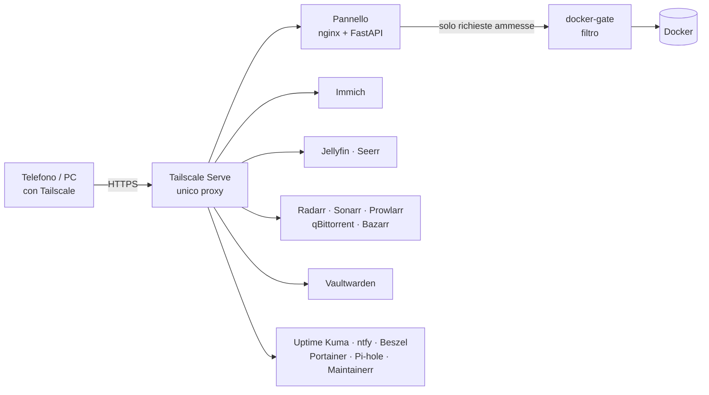
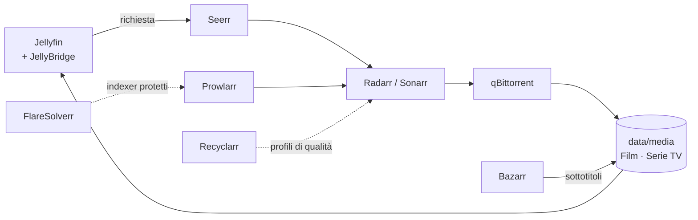

# Server-Privato

**Un home server completo in Docker, con un pannello web tutto suo.** Foto, film e serie, password, backup cifrati, blocco pubblicità e monitoraggio, raggiungibili da telefono e PC in HTTPS **senza aprire nessuna porta sul router**.


Pensato per un **Raspberry Pi** (8 GB di RAM consigliati) con un SSD esterno; funziona anche su un PC Linux o su Windows con WSL.

## Indice

- [Cosa include](#cosa-include)
- [Come è fatto](#come-è-fatto)
- [Servizi e porte](#servizi-e-porte)
- [Requisiti](#requisiti)
- [Installazione](#installazione)
- [Accesso da telefono e PC](#accesso-da-telefono-e-pc)
- [Il pannello](#il-pannello)
- [Dati e backup](#dati-e-backup)
- [Sicurezza](#sicurezza)
- [Risorse e ottimizzazione](#risorse-e-ottimizzazione)
- [Configurazione](#configurazione)
- [Comandi utili](#comandi-utili)
- [Aggiornare](#aggiornare)
- [API](#api)
- [Struttura del progetto](#struttura-del-progetto)
- [Documentazione](#documentazione)
- [Da decidere](#da-decidere)

## Cosa include

| Area | Servizi | A cosa serve |
|---|---|---|
| **Foto** | Immich | Backup e galleria foto, con riconoscimento di volti e ricerca per contenuto. Legge la tua libreria esistente in sola lettura |
| **Film e serie** | Jellyfin, Seerr, Radarr, Sonarr, Prowlarr, qBittorrent, Bazarr, FlareSolverr, Recyclarr, Maintainerr | Streaming, richieste direttamente da Jellyfin, download automatico, sottotitoli, profili di qualità sempre aggiornati e pulizia di ciò che non guardi più |
| **Password** | Vaultwarden | Password manager compatibile con le app Bitwarden |
| **Rete** | Pi-hole, Unbound, Tailscale | Blocco di pubblicità e tracker per tutta la casa, con DNS ricorsivo proprio; accesso da fuori e proxy HTTPS unico |
| **Controllo** | Pannello, Uptime Kuma, ntfy, Beszel, Portainer | Interruttori per ogni gruppo di servizi, controllo che tutto risponda, notifiche push, storico delle risorse e gestione grafica di Docker; recupero delle credenziali dalla scheda Accessi |
| **Backup** | Restic, backup di Vaultwarden | Archivi cifrati AES-256: Restic su disco esterno, solo manuale dall'admin; Vaultwarden automatico ogni notte |
| **Utility** | Diun, Autoheal, Unmanic | Avviso quando escono aggiornamenti, riavvio automatico di ciò che non risponde, compressione dei video in libreria |

## Come è fatto

Tutto passa da **Tailscale Serve**, l'unico reverse proxy del progetto: espone ogni servizio in HTTPS con un certificato valido, solo ai dispositivi del tuo account.



Il flusso dei contenuti multimediali:



Una cartella sola, `data/`, contiene tutto: configurazioni, foto, media e backup.

## Servizi e porte

Le porte sono pubblicate solo su `127.0.0.1`: dal telefono o da un altro PC si usa l'indirizzo Tailscale `https://<nome>.<rete>.ts.net:<porta>`.

| Servizio | Cosa fa | Porta sul server | Guida |
|---|---|---|---|
| Pannello | Gestisce tutti i servizi | 8088 (Tailscale: 443) | [pwa.md](docs/pwa.md) |
| Immich | Foto | 2283 | [immich.md](docs/immich.md) |
| Jellyfin | Film, serie, musica | 8096 | [jellyfin.md](docs/jellyfin.md) |
| Seerr | Richieste di film e serie | 5055 | [seerr.md](docs/seerr.md) |
| Radarr · Sonarr · Prowlarr | Film, serie, indexer | 7878 · 8989 · 9696 | [seerr.md](docs/seerr.md) |
| qBittorrent | Client di download | 8080 | [seerr.md](docs/seerr.md) |
| Bazarr · FlareSolverr | Sottotitoli · sfide Cloudflare | 6767 · nessuna | [bazarr.md](docs/bazarr.md) |
| Recyclarr | Profili di qualità di Radarr e Sonarr (TRaSH) | nessuna | [recyclarr.md](docs/recyclarr.md) |
| Maintainerr | Pulizia della libreria, con le tue regole | 6246 | [maintainerr.md](docs/maintainerr.md) |
| Vaultwarden | Password | Tailscale 8443 (dal server 8222, solo per emergenza) | [vaultwarden.md](docs/vaultwarden.md) |
| Pi-hole | DNS e blocco pubblicità | 53 · web 8053 (`/admin`) | [pihole.md](docs/pihole.md) |
| Unbound | DNS ricorsivo dietro Pi-hole | nessuna (rete interna) | [unbound.md](docs/unbound.md) |
| Uptime Kuma | Controllo dei servizi | 3001 | [uptime-kuma.md](docs/uptime-kuma.md) |
| ntfy | Notifiche push | 2586 | [ntfy.md](docs/ntfy.md) |
| Schermata iniziale | Pagina prima dell'accesso (React, video di sfondo) | nessuna | [schermata-iniziale.md](docs/schermata-iniziale.md) |
| ntfy → Telegram | Le stesse notifiche anche su Telegram (su richiesta) | nessuna | [telegram.md](docs/telegram.md) |
| Beszel | Storico di CPU, RAM, dischi e container | 8090 | [beszel.md](docs/beszel.md) |
| Portainer | Gestione di Docker | 9443 (certificato autofirmato) | [portainer.md](docs/portainer.md) |
| Diun · Autoheal | Avvisi di aggiornamento · riavvio automatico | nessuna | [manutenzione.md](docs/manutenzione.md) |
| Unmanic | Compressione video (di solito spento) | 8888 | [compressione.md](docs/compressione.md) |
| Copyparty | Scambio file tra dispositivi (web e WebDAV), cartella `scambio` | 3923 (di serie solo sul server) | [scambio-file.md](docs/scambio-file.md) |
| Syncthing | Sincronizza cartelle tra i tuoi dispositivi, solo via Tailscale | 8384 (sincronizzazione: Tailscale 22000) | [syncthing.md](docs/syncthing.md) |
| ConvertX | Convertitore di file (rete interna, di solito spento) | solo Tailscale 3000 | [convertx.md](docs/convertx.md) |
| Plex | Streaming sulla stessa libreria di Jellyfin (opzionale, di solito spento) | 32400 (127.0.0.1 o LAN con `PLEX_BIND_ADDR`, Tailscale) | [plex.md](docs/plex.md) |
| RomM | Libreria di ROM con gioco nel browser (opzionale, di solito spento) | solo Tailscale 8085 | [romm.md](docs/romm.md) |
| gluetun | VPN WireGuard per qBittorrent (opzionale, `compose.vpn.yml`) | nessuna | [vpn.md](docs/vpn.md) |
| rclone | Copia fuori sede dell'archivio Restic (a richiesta, `backup-remoto.sh`) | nessuna | [backup-remoto.md](docs/backup-remoto.md) |
| Tailscale | Accesso e proxy HTTPS | nessuna | [tailscale.md](docs/tailscale.md) |
| Restic | Backup (parte a richiesta) | nessuna | [restic.md](docs/restic.md) |

32 container, più Restic, rclone, ConvertX, Plex, RomM (con il suo database) e gluetun quando servono (ConvertX, Plex, RomM e gluetun si accendono dal pannello o con la VPN attiva). Unmanic (compressione) di solito resta spento: si accende dal pannello quando serve.

## Requisiti

- Un Raspberry Pi con **8 GB di RAM** (Immich consiglia almeno 4 GB), oppure un PC Linux, oppure Windows con WSL.
- Un SSD per i dati: filesystem **ext4** (Postgres e SQLite non vanno su exFAT o NTFS).
- Docker con il plugin Compose (`setup-windows.bat` e `install-linux.sh` lo installano su Ubuntu se manca).
- Un account Tailscale gratuito per l'accesso da fuori casa.

Spazio: circa 30 GB più 1,3 volte le tue foto. I film e le serie occupano quanto servono.

## Installazione

### Linux

```bash
./src/scripts/gen-api-token.sh   # token del pannello: mostrato una sola volta, copialo
./src/scripts/start.sh           # prepara .env e cartelle, poi avvia i container
```

### Windows (con WSL)

Doppio clic su `setup-windows.bat`. Installa Ubuntu e Docker se mancano, prepara tutto, imposta la RAM di WSL e lo avvia a ogni accesso. Guida completa, con lo spostamento su SSD esterno: [windows.md](docs/windows.md).

### Cosa fa il primo avvio

Non serve toccare il `.env`: lo crea `start.sh` tramite `sync-env.sh`, insieme a tutte le cartelle in `data/`.

- Genera le passphrase dei backup di Restic e di Vaultwarden e te le mostra **una sola volta**: **copiale fuori dal server**.
- Se vuoi, attiva il backup notturno di Vaultwarden.
- Se il pannello mostra un avviso su cartelle mancanti o di root, rilancia `./src/scripts/sync-env.sh`. Non lanciare mai gli script con `sudo`.

### Gli script di avvio, a cascata

Chi chiama chi, nell'ordine in cui succede. Da Linux si parte da `install-linux.sh` (primo giorno) o da `start.sh` (tutti i giorni dopo); da Windows da `setup-windows.bat`. Gli script si lanciano col proprio utente, **mai con `sudo`**.

```text
setup-windows.bat                      solo Windows: installa WSL/Ubuntu, poi chiama...
└─ src/scripts/install-linux.sh        primo giorno, 6 passi guidati (su Linux si lancia direttamente)
   ├─ 2. installa Docker se manca
   ├─ 3. sync-env.sh                   .env, cartelle in data/, passphrase dei backup
   ├─ 4. chiave Tailscale              la chiede e la scrive nel .env
   ├─ 5. gen-api-token.sh              token del pannello (se non c'è già)
   └─ 6. docker compose up -d --build  NON chiama start.sh: post-avvio.sh e riapplica-stato.sh vanno poi a mano

src/scripts/start.sh                   ogni avvio successivo: costruisce e avvia tutto
├─ 1. sync-env.sh                      aggiorna .env e cartelle (si può rilanciare quando vuoi)
├─ 2. avviso se manca il token         → gen-api-token.sh, poi di nuovo start.sh
├─ 3. docker compose up -d --build --remove-orphans
├─ 4. post-avvio.sh                    chiavi di Radarr/Sonarr per Recyclarr e chiave del hub Beszel
├─ 5. docker compose --profile telegram up -d ntfy-telegram   solo se telegram-setup.sh è già stato fatto
└─ 6. riapplica-stato.sh               rispegne ciò che avevi spento dal pannello
```

Gli script che lanci **a mano**, quando serve:

| Script | Quando | Prima serve |
|---|---|---|
| `gen-api-token.sh` | primo avvio, o per ruotare il token (poi `docker compose up -d backend`) | `.env` |
| `post-avvio.sh` | se `start.sh` ha detto che Recyclarr o Beszel non erano pronti: rilancialo dopo qualche minuto | servizi avviati |
| `telegram-setup.sh` | una volta, per il ponte Telegram ([guida](docs/telegram.md)) | `start.sh`, ntfy acceso |
| `backup-disco.sh` | una volta, per mettere l'archivio Restic su un disco esterno ([guida](docs/restic.md)) | `start.sh`, disco montato |
| `pihole-unbound.sh on` | una volta, per far usare Unbound a Pi-hole ([guida](docs/unbound.md)) | Pi-hole e Unbound accesi |
| `pin-images.sh` | facoltativo, per fissare le immagini alle versioni in uso (`--apply` scrive nel `.env`) | `.env` e servizi avviati |
| `riapplica-stato.sh` | se dopo un `docker compose up` ricompaiono servizi che avevi spento dal pannello | servizi avviati |
| `fix-immich-db.sh` | solo se Immich scrive *password authentication failed* | `.env`, container Postgres acceso |
| `recupera-credenziali.sh` | se perdi una password salvata in chiaro (Pi-hole, Immich, passphrase) | `.env` |
| `backup-vaultwarden.sh` | a richiesta; di notte lo lancia cron se lo hai attivato in `sync-env.sh` | `.env` |
| `check-config.py` | prima di un push o dopo aver toccato compose, porte o backup: dice se gli elenchi sono allineati | solo Python 3 e `docker compose config` |
| `check-arm64.sh` | prima di passare al Raspberry, per vedere se tutte le immagini hanno la versione ARM64 | rete verso i registri |

### Dopo l'avvio

1. Apri il pannello su http://localhost:8088 e inserisci il token.
2. Sezione **Backup**: collega il disco esterno e lancia `./src/scripts/backup-disco.sh`, poi *Prepara l'archivio* (una volta sola). Senza disco l'archivio resta in `data/backups/restic`.
3. Configura Tailscale: [tailscale.md](docs/tailscale.md).
4. Crea gli amministratori dei servizi, nell'ordine che preferisci:
   - **Vaultwarden:** il tuo account, poi `VW_SIGNUPS=false` e la 2FA ([guida](docs/vaultwarden.md));
   - **Radarr, Sonarr, Prowlarr:** *Autenticazione: Obbligatoria* ([guida](docs/seerr.md));
   - **Bazarr:** autenticazione ([guida](docs/bazarr.md));
   - **Uptime Kuma e Portainer:** il primo amministratore, subito dopo l'avvio ([Kuma](docs/uptime-kuma.md), [Portainer](docs/portainer.md));
   - **ntfy:** il tuo utente ([guida](docs/ntfy.md));
   - **Telegram** (facoltativo): `./src/scripts/telegram-setup.sh` ([guida](docs/telegram.md));
   - **Diun:** un token ntfy (`DIUN_NTFY_TOKEN`) per le notifiche degli aggiornamenti ([guida](docs/manutenzione.md));
   - **Beszel:** il primo amministratore e il sistema `/beszel_socket/beszel.sock` ([guida](docs/beszel.md));
   - **Recyclarr, Maintainerr, Unbound:** una sincronizzazione di prova, il collegamento a Jellyfin, Radarr e Sonarr, e `./src/scripts/pihole-unbound.sh on` ([Recyclarr](docs/recyclarr.md), [Maintainerr](docs/maintainerr.md), [Unbound](docs/unbound.md)).

Avvio parziale: `docker compose up -d --build frontend backend vaultwarden`.

## Accesso da telefono e PC

Tailscale crea una rete privata tra i tuoi dispositivi e pubblica i servizi in HTTPS, senza aprire porte sul router e anche dietro CGNAT. Le porte pubblicate sono 16 e le elenca `tailscale/serve.json`.

1. Installa l'app Tailscale e accedi con lo stesso account.
2. Apri `https://<nome>.<rete>.ts.net` per il pannello, oppure aggiungi la porta del servizio, per esempio `:8096` per Jellyfin.
3. Dal browser installa il pannello come app ([pwa.md](docs/pwa.md)).

Per un dispositivo senza Tailscale, come una TV con Jellyfin, serve `LAN_BIND_ADDR` nel `.env` (meglio l'indirizzo fisso del server che `0.0.0.0`) e un firewall che lasci entrare solo la rete di casa. Vale solo per Jellyfin e Seerr: tutte le altre porte restano sul server stesso.

## Il pannello

Una PWA a quattro sezioni, in HTML e JavaScript senza librerie.

- **Servizi:** in alto i pulsanti delle **modalità** (Risparmio e Normale, [guida](docs/risparmio.md)); poi una scheda per gruppo con stato, CPU, RAM, tempo di attività, salute e riavvii; interruttori di avvio, arresto e riavvio; link "Apri". Mostra anche CPU, carico, RAM, dischi, temperatura e uptime del server.
- **Backup:** prepara l'archivio, avvia il backup, pulisce le copie vecchie, controlla l'archivio e mostra log e copie esistenti.
- **Rete:** stato di Tailscale, indirizzo HTTPS, dispositivi collegati e installazione dell'app.
- **Accessi:** dove stanno le credenziali di ogni servizio e il comando per recuperarle. Il pannello non mostra e non reimposta nessuna password: il recupero si fa dal terminale del server con `./src/scripts/recupera-credenziali.sh` ([guida](docs/credenziali.md)).

Il blocco **Utility** raccoglie le schede di servizio al server: **Manutenzione** (Diun e Autoheal, sempre accesi) e **Compressione video** (Unmanic, acceso solo quando serve). Un servizio entra nel blocco con `"group": "utility"` in `src/backend/app/services.py`.

Gli interruttori sono il modo più semplice per risparmiare RAM: **Download automatici** (sei servizi), **Immich, riconoscimento** e **Compressione video** si spengono quando non servono. Tailscale non si ferma dal pannello, perché perderesti l'accesso.

## Dati e backup

```
data/
├── media/          Film · Serie TV · Discoveries · downloads
├── photos/         la tua libreria foto (Immich la legge in sola lettura)
├── immich/         upload · postgres · model-cache
├── vaultwarden/    pihole/    jellyfin/    seerr/    radarr/    sonarr/
├── prowlarr/       qbittorrent/    bazarr/    kuma/    ntfy/    portainer/
├── unmanic/        diun/    recyclarr/    maintainerr/    beszel/
├── tailscale/      panel/    telegram/    syncthing/    sync/    scambio/
├── copyparty/      convertx/    rclone/    gluetun/
└── backups/        restic · vaultwarden
```

**Restic** salva in un archivio cifrato (AES-256, deduplicato) Vaultwarden, foto e dump di Immich, Pi-hole e le configurazioni di Jellyfin, Seerr, Radarr, Sonarr, Prowlarr, qBittorrent, Recyclarr e Maintainerr. Va su un disco esterno e parte **solo quando l'amministratore lo avvia dal pannello**, col disco collegato (`./src/scripts/backup-disco.sh` lo configura); la pulizia, che tiene 7 copie giornaliere, 4 settimanali e 6 mensili, è un pulsante a parte. Se l'ultima copia è più vecchia di `BACKUP_WARN_DAYS` giorni il pannello avvisa. Film e download non sono inclusi. Dettagli e ripristino: [restic.md](docs/restic.md).

**Backup di Vaultwarden:** archivio cifrato con GnuPG, notturno alle 03:00 se lo attivi, ultime 14 copie.

Attenzione:
- la passphrase si copia **fuori dal server**, senza i backup non si aprono;
- la copia di Restic sta sul disco di casa: per averla anche fuori casa c'è `./src/scripts/backup-remoto.sh` ([backup-remoto.md](docs/backup-remoto.md), da attivare tu);
- Portainer e Diun non sono tra le fonti di Restic (si riconfigurano in pochi minuti); tutti gli altri servizi, compreso lo stato del pannello e l'identità Tailscale, sì.

## Sicurezza

Obiettivo realistico: un server in casa, raggiungibile da fuori **solo** via Tailscale. Dettagli in [security.md](docs/security.md).

- **Nessuna porta aperta** sul router. Le porte dei servizi stanno tutte su `127.0.0.1`; solo Jellyfin e Seerr possono essere aperti alla rete di casa (`LAN_BIND_ADDR`).
- **Socket Docker:** equivale a root. Lo montano per intero Portainer (solo su richiesta, profilo `admin-tools`) e l'agente Beszel. Il pannello passa da `docker-gate`, un filtro che guarda anche il corpo delle richieste (nessun container arbitrario, due `exec` fissi); Diun e Autoheal da due proxy a permessi minimi. Le porte restano sempre locali e il pannello richiede un token.
- **Reti separate:** ogni gruppo di servizi ha la sua rete ([reti.md](docs/reti.md)): i download non vedono Vaultwarden, Jellyfin, i database né il pannello.
- **Token del pannello:** 256 bit casuali, nel `.env` c'è solo l'hash SHA-256. Letto solo dall'header, confronto a tempo costante, blocco dopo 10 errori al minuto.
- **Pannello web:** CSP rigida, niente script o stili inline, `X-Frame-Options: DENY`. Unica apertura: il video della schermata iniziale ([dettagli](docs/security.md#schermata-iniziale-e-video-esterno)).
- **Pannelli pubblicati da Tailscale:** Radarr, Sonarr e Prowlarr vedono le richieste come locali, quindi l'autenticazione obbligatoria va impostata in ciascuno. ntfy è in `deny-all`.
- **Unmanic** non ha nessuna autenticazione (e Maintainerr, di serie, nemmeno): le porte sono su `127.0.0.1` e da fuori si arriva solo da Tailscale. Non aprirle in LAN.
- **Credenziali dimenticate:** il recupero passa solo dal terminale del server (`recupera-credenziali.sh`), mai dal pannello web ([guida](docs/credenziali.md)).
- **Cifratura:** vault AES-256 lato client, backup AES-256, traffico WireGuard più HTTPS.
- **Pi-hole:** nel `.env.example` il DNS ascolta su un IP della LAN e la pagina web su `0.0.0.0`. È l'unica eccezione al "tutto locale": controlla che sia voluta.

## Risorse e ottimizzazione

- **Limiti di RAM:** Immich ML 3 GB e Unmanic 2 GB (prudenti, non misurati sul tuo server). Unmanic ha anche un tetto di 2 core (`UNMANIC_CPUS`). Il gruppo Download (qBittorrent, FlareSolverr, Radarr, Sonarr, Prowlarr, Bazarr) **non ha limiti**: per liberare risorse si spegne dal pannello, anche con la modalità Risparmio.
- **Priorità CPU bassa** per Immich ML, Unmanic, Diun e Autoheal.
- **Protezione dall'esaurimento di RAM:** Vaultwarden e Tailscale sono gli ultimi a essere fermati da Linux.
- **Log a rotazione:** 3 file da 10 MB per container.
- **Backup Restic** a bassa priorità e con al massimo 2 core.
- **Pannello leggero:** stato ogni 5 secondi, statistiche ogni 15, nessuna attività a scheda in secondo piano.

Impostazioni da ritoccare dentro i servizi (Immich, Jellyfin, arr, qBittorrent): [ottimizzazione.md](docs/ottimizzazione.md).

## Configurazione

Il `.env` lo gestisce `sync-env.sh`. Le variabili che può avere senso cambiare:

| Variabile | Significato |
|---|---|
| `LAN_BIND_ADDR` | Dove pubblicare le porte di Jellyfin e Seerr (le sole apribili in LAN): `127.0.0.1` (solo dal server, consigliato), l'IP del server o `0.0.0.0`. Sostituisce `BIND_ADDR`, ancora letto se manca |
| `*_IMAGE`, `IMMICH_VERSION` | Versione fissa delle immagini (di serie `latest`): `./src/scripts/pin-images.sh` ([manutenzione.md](docs/manutenzione.md)) |
| `TS_HOSTNAME`, `TS_AUTHKEY`, `TS_ROUTES` | Nome del server in Tailscale, chiave per il primo accesso, IP da pubblicare per usare Pi-hole fuori casa |
| `RECYCLARR_SCHEDULE`, `RADARR_API_KEY`, `SONARR_API_KEY` | Orario di Recyclarr e chiavi API (le scrive `post-avvio.sh`) |
| `BESZEL_KEY`, `BESZEL_APP_URL` | Chiave pubblica del hub per l'agente (la scrive `post-avvio.sh`) e indirizzo `.ts.net` del hub |
| `API_TOKEN_HASH` | Hash del token del pannello (lo scrive `gen-api-token.sh`) |
| `IMMICH_DB_PASSWORD` | Password del database di Immich: scegli lettere e numeri **prima** del primo avvio |
| `VW_DOMAIN`, `VW_SIGNUPS`, `ADMIN_TOKEN` | Indirizzo `.ts.net` di Vaultwarden, registrazioni aperte o chiuse, pannello `/admin` |
| `NTFY_BASE_URL` | Indirizzo `.ts.net` di ntfy per l'app sul telefono |
| `PIHOLE_DNS_BIND`, `PIHOLE_WEB_BIND` | Dove ascoltano il DNS e la pagina web di Pi-hole |
| `BACKUP_DISK_DIR`, `BACKUP_MOUNT_PARENT` | Punto di montaggio del disco di backup e la sua cartella madre (li scrive `backup-disco.sh`; vuoti = archivio locale) |
| `BACKUP_WARN_DAYS` | Giorni dopo i quali il pannello avvisa che manca un backup (14; `0` = mai) |
| `TZ`, `PUID`, `PGID` | Fuso orario e utente con cui girano i container |

I percorsi dei dati non si configurano: sono fissi in `data/`. `./src/scripts/sync-env.sh --percorsi` riallinea il `.env` senza spostare dati già esistenti.

## Comandi utili

```bash
docker compose ps                              # stato dei container
docker compose logs -f jellyfin                # log di un servizio
docker compose pull && docker compose up -d    # aggiorna le immagini
docker compose exec tailscale tailscale serve status    # cosa pubblica Tailscale

docker compose exec ntfy ntfy user add --role=admin IL_TUO_NOME      # utente di ntfy
docker compose --profile tools run --rm restic -r /repo snapshots    # copie di Restic
./src/scripts/backup-vaultwarden.sh            # backup cifrato di Vaultwarden, a mano
./src/scripts/backup-disco.sh --stato         # disco di backup Restic: configurazione e collegamento
./src/scripts/recupera-credenziali.sh          # password dimenticata: elenco dei comandi di recupero
./src/scripts/pihole-unbound.sh stato          # Pi-hole usa Unbound? (on / off per cambiare)
./src/scripts/post-avvio.sh                    # chiavi di Radarr/Sonarr per Recyclarr e chiave del hub Beszel
```

## Aggiornare

Estrai il nuovo codice, tieni il tuo `.env`, poi `./src/scripts/start.sh`. Lo script riallinea i percorsi a `data/`, ma **non sposta** dati che si trovano altrove: copiali a servizi fermi dopo aver letto il messaggio di avviso.

Dalle versioni precedenti:
- **Caddy** non c'è più. Vaultwarden si apre da `https://<nome>.<rete>.ts.net:8443`: imposta `VW_DOMAIN` nel `.env`; la cartella `data/caddy` si può cancellare.
- **Portainer:** se aveva i dati in `homeserver-data/portainer`, copiali in `data/portainer` ([portainer.md](docs/portainer.md)).
- **SteamCMD** è stato rimosso: se avevi giochi in `data/steam-games`, spostali o cancellali a mano.

Le immagini usano spesso `latest`: leggi le note di rilascio prima di aggiornare, soprattutto per Immich, e fai prima un backup.

## API

Le rotte protette richiedono l'header `X-API-Token`. Con un token mancante o errato rispondono `401`. Se il server non ha configurato un token valido rispondono `503`.

| Metodo | Path | Descrizione |
|---|---|---|
| GET | `/api/health` | stato del backend, sempre senza token |
| GET | `/api/session` | verifica il token senza contattare Docker |
| GET | `/api/services` · `/api/services/{id}` | stato dei gruppi di servizi (`immich`, `immich-ml`, `jellyfin`, `seerr`, `maintainerr`, `download`, `vaultwarden`, `pihole`, `uptime-kuma`, `ntfy`, `beszel`, `portainer`, `manutenzione`, `compressione`, `tailscale`) |
| POST | `/api/services/{id}/start` · `stop` · `restart` | azione su un gruppo |
| GET | `/api/modes` | le modalità del pannello (Risparmio, Normale) |
| POST | `/api/modes/{id}/apply` | applica una modalità: accende o spegne in blocco i suoi gruppi |
| GET | `/api/stats` | server (CPU, RAM, dischi, temperatura) e per servizio (CPU, RAM, uptime, salute, riavvii); segnala cartelle mancanti |
| GET | `/api/tailscale/status` | stato Tailscale, indirizzo HTTPS, dispositivi |
| GET | `/api/access` | elenco delle credenziali e comandi di recupero (nessun valore segreto) |
| GET | `/api/backup/status` · `/api/backup/snapshots` | stato del backup e copie Restic |
| GET | `/api/backup/jobs/current/logs?tail=60` | ultime righe del job Restic |
| POST | `/api/backup/jobs` | avvia un job Restic |

## Struttura del progetto

```
Server-Privato/
├── compose.yaml          i servizi, con limiti di risorse e log a rotazione
├── compose.override.yml  aggiunte specifiche per Immich
├── compose.vpn.yml       opzionale: qBittorrent dietro una VPN WireGuard (gluetun)
├── .env.example          modello del .env (lo crea sync-env.sh)
├── setup-windows.bat     installazione automatica su Windows
├── src/
│   ├── backend/          FastAPI: servizi Docker, statistiche, backup Restic, stato Tailscale, elenco accessi
│   ├── frontend/         PWA React compilata con Vite
│   ├── hero/             schermata iniziale in React (si compila nella build del frontend)
│   ├── docker-gate/      filtro del socket Docker per il backend (gate.py) e le sue prove (test_gate.py)
│   ├── Dockerfile.frontend   nginx + PWA + hero compilato
│   └── scripts/          start.sh · sync-env.sh · post-avvio.sh · gen-api-token.sh · telegram-setup.sh · backup-disco.sh · recupera-credenziali.sh · pin-images.sh · riapplica-stato.sh · check-config.py · check-arm64.sh · pihole-unbound.sh · backup-vaultwarden.sh · install-linux.sh · backup-remoto.sh · copyparty-setup.sh · syncthing-setup.sh · smart-check.sh · vpn-setup.sh · vpn-test.sh
├── nginx/                serve il pannello (CSP e header di sicurezza)
├── unbound/              unbound.conf: DNS ricorsivo dietro Pi-hole
├── recyclarr/            recyclarr.yml: modello dei profili di qualità (la copia in uso sta in data/)
├── tailscale/            serve.json: i servizi pubblicati in HTTPS
├── docs/                 una guida per servizio
└── data/                 dati persistenti (creata all'avvio, non nel repository)
```

## Documentazione

| Argomento | Guida |
|---|---|
| Foto | [immich.md](docs/immich.md) |
| Film, serie e musica | [jellyfin.md](docs/jellyfin.md) · [seerr.md](docs/seerr.md) · [bazarr.md](docs/bazarr.md) · [recyclarr.md](docs/recyclarr.md) · [maintainerr.md](docs/maintainerr.md) |
| Password | [vaultwarden.md](docs/vaultwarden.md) |
| Rete e accesso | [tailscale.md](docs/tailscale.md) · [reti.md](docs/reti.md) · [pihole.md](docs/pihole.md) · [unbound.md](docs/unbound.md) · [raspberry.md](docs/raspberry.md) |
| Controllo e notifiche | [uptime-kuma.md](docs/uptime-kuma.md) · [ntfy.md](docs/ntfy.md) · [telegram.md](docs/telegram.md) · [beszel.md](docs/beszel.md) · [portainer.md](docs/portainer.md) |
| Utility | [manutenzione.md](docs/manutenzione.md) · [compressione.md](docs/compressione.md) · [risparmio.md](docs/risparmio.md) |
| Backup e dischi | [restic.md](docs/restic.md) · [backup-remoto.md](docs/backup-remoto.md) · [smart.md](docs/smart.md) |
| File e sincronizzazione | [scambio-file.md](docs/scambio-file.md) · [syncthing.md](docs/syncthing.md) · [convertx.md](docs/convertx.md) · [plex.md](docs/plex.md) · [romm.md](docs/romm.md) · [streamyfin.md](docs/streamyfin.md) |
| VPN e accesso remoto | [vpn.md](docs/vpn.md) · [rustdesk.md](docs/rustdesk.md) |
| Sicurezza e credenziali | [security.md](docs/security.md) · [credenziali.md](docs/credenziali.md) |
| Risorse | [ottimizzazione.md](docs/ottimizzazione.md) |
| Pannello sul telefono | [pwa.md](docs/pwa.md) |
| Windows e SSD esterno | [windows.md](docs/windows.md) |

## Da decidere

- Una seconda destinazione per i backup, fuori dal disco del server (`restic copy` verso un secondo archivio): serve scegliere dove.
- Un'unica fonte per servizi, porte e backup (etichette `hs.*` nel compose, scoperta dinamica nel backend): oggi sono più elenchi tenuti allineati a mano, e `src/scripts/check-config.py` segnala quando divergono.
- Altre utility da valutare: Filebrowser, CrowdSec e Watchtower (Diun avvisa soltanto; Watchtower aggiornerebbe da solo).
- Spegnimento programmato e limiti di RAM calibrati sull'uso reale.
- Navidrome per la musica.
- Una copia dei backup fuori casa.
